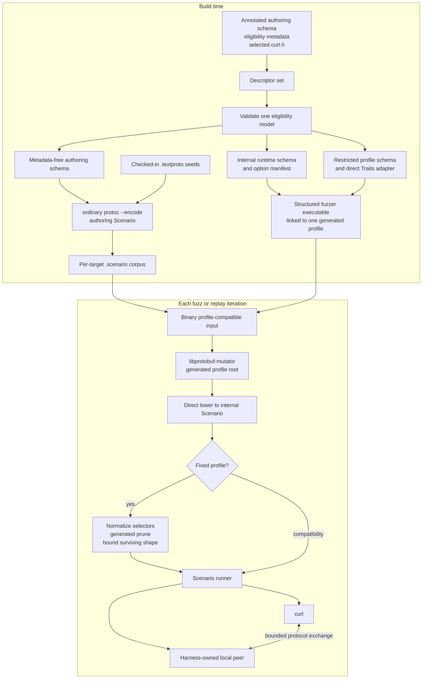

# Structured fuzzers

The structured fuzzer suite models a curl transfer with one annotated protobuf
authoring schema. The build derives a restricted root for each target.
[libprotobuf-mutator](https://github.com/google/libprotobuf-mutator) mutates
that target-specific type rather than an unstructured byte stream, and a
generated adapter lowers it into the common runtime before the harness runs
curl against a bounded local peer.

The targets still consume ordinary binary protobuf files. Textprotos under
`scenarios/curl_fuzzer_proto/` are readable full-authoring seed sources; CMake
encodes them under `build/generated_corpora/`.

## How an input reaches curl



`SetOption` is an ordered oneof of typed fields. Each field declares its stable
protobuf tag, native `CURLOPT_*` identity, and profile membership beside the
value. Structured fields carry the same kind of eligibility metadata. The
generator checks those declarations against the selected curl checkout's
`curl.h`, then derives the internal `CurlOptionId`, value-kind manifest,
profile cases, and direct transfers. There is no parallel handwritten C++
option allowlist.

The metadata-free authoring view is staged at
`build/schemas/curl_fuzzer.proto`. Normal checked-in textprotos are encoded
against that full view with ordinary `protoc --encode`. Generated restricted
roots keep the same field numbers and wire types, so a target can parse those
bytes directly and discard unknown fields. No separate per-profile seed encoder
is required.

Each thin entrypoint binds the shared runtime to generated Traits for one
profile. Mutation, crossover, and loading all use that exact concrete message
type. Static profile projection prevents unsupported fields from entering the
mutation graph. Generated conditional pruning runs after selector
normalization and before limits, while C++ continues to own scheme fixing,
selector canonicalization, work bounds, resource lifetimes, and peer behavior.
The compatibility target uses a generated broad root and keeps its historical
mixed execution mode; the schema format itself still changed in place.

Pre-cutover binaries are not automatically detected or loaded. Reproduce them
with the revision and target that created them.

The peers are owned by the harness. Stream protocols generally use local
socket pairs; TFTP and HTTP/3 use private loopback UDP endpoints. Baseline curl
configuration disables ambient proxies, restricts protocols, redirects direct
connections to the harness, and uses short timeouts. A new target or option
must preserve those isolation guarantees.

## Build and replay a scenario

Build one structured target and its generated seed corpus:

```shell
./mainline.sh -t curl_fuzzer_proto_http
```

Replay one seed with the standalone runner:

```shell
./build/curl_fuzzer_proto_http \
  build/generated_corpora/curl_fuzzer_proto_http/basic_get.scenario
```

The standalone executable accepts files and directories, so an entire
target-specific seed set can be replayed too:

```shell
./build/curl_fuzzer_proto_http \
  build/generated_corpora/curl_fuzzer_proto_http/
```

Set `FUZZ_VERBOSE=1` when a reproduction needs curl's protocol trace. These
locally built executables replay inputs; OSS-Fuzz builds provide the active
libFuzzer mutation engine.

Continue with [Writing and inspecting scenarios](scenarios.md), then consult
[Target profiles](target-profiles.md) before choosing a corpus or adding a
field. The [C++ reference](cpp-reference.md) documents the implementation's
classes, functions, and ownership contracts.
